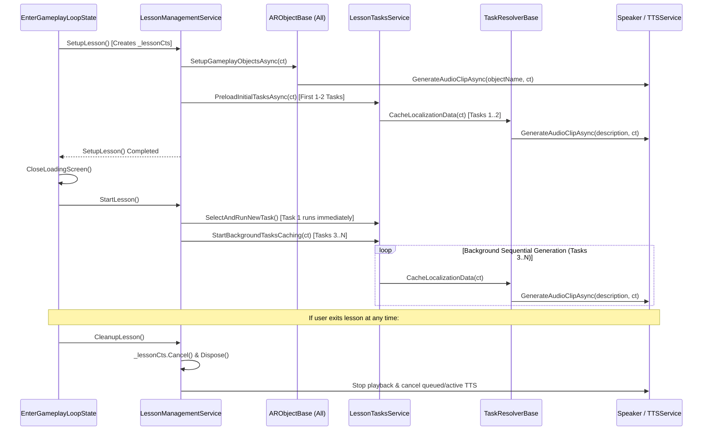

# TTS Audio Preloading & Background Generation Architecture

## 1. Problem Overview
Currently, when a lesson starts (`EnterGameplayLoopState` -> `LessonManagementService.SetupLesson()`):
1. **AR Objects**: `ARObjectBase.Initialize()` starts `CacheLicalization().Forget()` (fire-and-forget without cancellation support), which requests TTS audio clip generation via `Speaker.GenerateAudioClipAsync()`.
2. **All Lesson Tasks**: `LessonTasksService.ChacheTasksLocalization()` runs `UniTask.WhenAll` over **all** tasks in the lesson queue, waiting for every task's TTS audio clip to finish generating before the loading screen closes.
3. **Contention & Startup Delay**: Because `Speaker` serializes requests with `SemaphoreSlim(1, 1)` and Sherpa ONNX synthesizes speech on the device CPU, generating audio for all objects and all tasks upfront causes a long wait time on mobile devices before gameplay can begin.
4. **No Cancellation on Exit**: Exiting a lesson (`GameplaySerttingsView.OnCloseGameplay()` or `LessonManagementService.LoadMainMenu()`) cleans up lesson objects and tasks, but any ongoing/queued TTS generations continue running in the background because no `CancellationToken` is propagated.

---

## 2. Proposed Solution & Execution Flow

---

## 3. Component-by-Component Changes

### 3.1. Speech Synthesis Layer (`ITTSService`, `TTSService`, `Speaker`)
* **`ITTSService` & `TTSService`**:
  * Update signature: `UniTask<AudioClip> GenerateAudioClip(string text, CancellationToken cancellationToken = default)`.
  * Pass `cancellationToken` into `_synthesizer.GenerateClipAsync(text.Trim(), cancellationToken: cancellationToken)`.
  * Add `void CancelActiveGeneration()` to `ITTSService` and `TTSService` (calls `_synthesizer.CancelActiveGeneration()`).
* **`Speaker`**:
  * Update `GenerateAudioClipAsync(string text, CancellationToken cancellationToken = default)`:
    * Pass `cancellationToken` to `await _operationLock.WaitAsync(cancellationToken)`. Tasks waiting in line when the lesson exits will cancel immediately without invoking ONNX.
    * Pass `cancellationToken` to `await _ttsService.GenerateAudioClip(text, cancellationToken)`.
    * Handle `OperationCanceledException` cleanly (returning `null` without logging false warnings/errors) and ensure `_operationLock.Release()` is only called when the lock was acquired.
  * Update `SpeakAsync(string text, CancellationToken cancellationToken = default)` to forward the token.
  * Add `Stop()` to stop `_audioSource` and cancel active TTS generation on lesson cleanup.

### 3.2. AR Objects (`ARObjectBase`)
* Replace the fire-and-forget `CacheLicalization()` inside `Initialize()` with an explicit async method:
  * `public async UniTask CacheLocalizationAsync(CancellationToken cancellationToken = default)`
* Resolves `_model.Name` via `_localization.GetStringAsync(...)`, checks `cancellationToken`, and awaits `_speaker.GenerateAudioClipAsync(_model.Name, cancellationToken)`.
* Skip TTS generation if `_perspective == Perspective.Video` (optional optimization, or generate as usual).

### 3.3. Task Resolvers (`TaskResolverBase`)
* Update `CacheLocalizationData(CancellationToken cancellationToken = default)`:
  * Guard against duplicate execution by tracking caching state (`_isTargetsResolved`, `_cachingTask`) so that if a player reaches a task while its background generation is still in progress (or already finished), `Run` / `CacheLocalizationData` reuses the in-flight or completed operation instead of generating twice.
  * Resolve targets and localized `_cachedDescription` first, then generate `_cachedAudioClip = await _speaker.GenerateAudioClipAsync(_cachedDescription, cancellationToken)`.
* Update `Run(ActiveTaskData viewData)`:
  * If `_cachedAudioClip` is already generated (which is guaranteed for Tasks 1–2 and usually true for later tasks), set `viewData.TaskDescription`, `viewData.TaskAudioClip`, and play immediately.
  * Fallback safety: if the player completes tasks faster than background TTS finishes and reaches Task $k$ while Task $k$ is still generating, `Run` sets the description as soon as available and awaits completion of `CacheLocalizationData` before assigning `viewData.TaskAudioClip` and calling `_speaker.Speak(...)` (unless the task is disposed/completed first).

### 3.4. Lesson Tasks Service (`LessonTasksService`)
* Add constant/parameter `private const int InitialTasksToPreload = 2;`.
* Split `ChacheTasksLocalization()` into two methods:
  1. `public async UniTask PreloadInitialTasksAsync(CancellationToken cancellationToken = default)`:
     * Takes the first `InitialTasksToPreload` tasks from `_taskList` and awaits `task.CacheLocalizationData(cancellationToken)` sequentially in queue order.
  2. `public void StartBackgroundTasksCaching(CancellationToken cancellationToken = default)`:
     * Creates a linked `CancellationTokenSource` (`_backgroundCachingCts`) and starts `CacheRemainingTasksInBackgroundAsync(_backgroundCachingCts.Token).Forget()`.
     * Iterates through `_taskList.Skip(InitialTasksToPreload).ToArray()` sequentially in queue order so Task 3 is generated before Task 4, Task 4 before Task 5, etc.
* In `Dispose()`:
  * Cancel and dispose `_backgroundCachingCts`.
  * Stop any active transition coroutine (`DelayBeforeSelectNextTask`) if the user exits the lesson during the 1-second delay after completing a task.

### 3.5. Lesson Management Service & State (`LessonManagementService`, `EnterGameplayLoopState`)
* **`LessonManagementService`**:
  * Add `private CancellationTokenSource _lessonCts;`.
  * In `SetupLesson()`:
    * Reset and create `_lessonCts = new CancellationTokenSource()`.
    * `await SetupGameplayObjectsAsync(_lessonCts.Token)` — instantiates all lesson `ARObjectBase` instances and awaits their `CacheLocalizationAsync(_lessonCts.Token)`.
    * `await SetupQuestsAsync(_lessonCts.Token)` — creates `_lessonTasksService` and awaits `_lessonTasksService.PreloadInitialTasksAsync(_lessonCts.Token)`.
  * In `StartLesson()`:
    * Calls `_lessonTasksService.SelectAndRunNewTask()`.
    * Calls `_lessonTasksService.StartBackgroundTasksCaching(_lessonCts.Token)`.
    * Subscribes to `_lessonTasksService.OnLessonComplete`.
  * In `CleanupLesson()`:
    * Cancels and disposes `_lessonCts`.
    * Stops speaker audio (`_arCameraProvider.GetSpeaker()?.Stop()`).
    * Disposes `_lessonTasksService` and cleans up `_lessonObjects`.
* **`EnterGameplayLoopState`**:
  * Guard `SetupLesson()` with `try / catch (OperationCanceledException)` and check if the state was exited before calling `_lessonManagementService.StartLesson()`.
